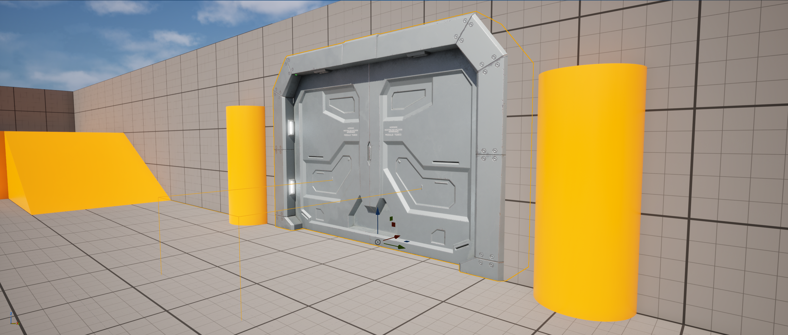
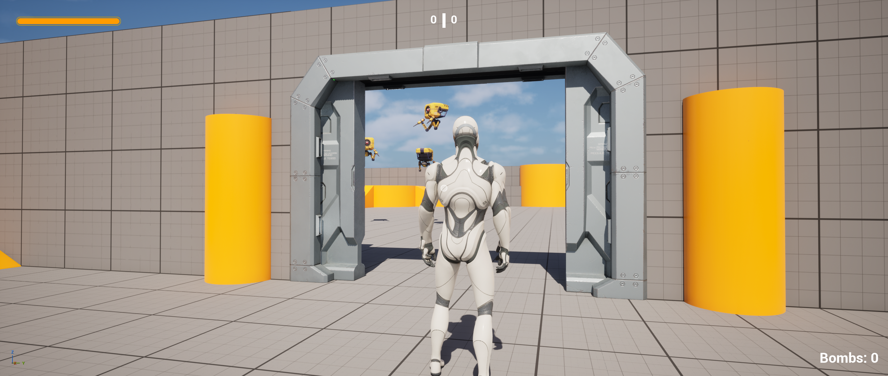
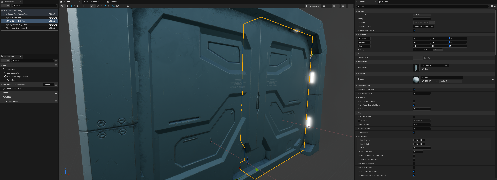
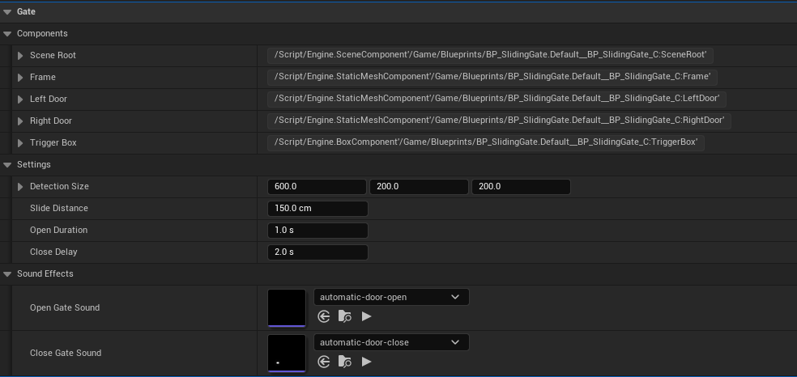

# Automatic Sliding Doors — Unreal Engine C++

A two-panel automatic sliding gate created in Unreal Engine. This repository showcases the mechanic through C++ source code, a demonstration video, and editor and gameplay screenshots.

## Demo Video

[▶ Watch the demo on YouTube](https://youtu.be/tFfd2vkTtos)

## Features

- Two door panels sliding in opposite directions.
- Player detection using a configurable box overlap area.
- Automatic opening when the player enters the detection area.
- Doors remain open while the player is inside.
- Configurable closing delay after the player leaves.
- Returning cancels the closing timer and reverses closing from the current position.
- Frame-rate-independent movement using `DeltaTime` and a normalized opening amount.
- Separate opening and closing sound effects, played once per change of target state.
- Editor-exposed settings organized into `Gate|Components`, `Gate|Settings`, and `Gate|Sound Effects`.
- Detection box updates in the editor through `OnConstruction()`.
- A missing player pawn is treated as outside the detection area, allowing the gate to close.

## Scene Preview

### Gate Placement and Detection Area

### Open Gate During Gameplay

## C++ Implementation

The mechanic is implemented in [`ASlidingGate`](SlidingGate.h), with behavior defined in [`SlidingGate.cpp`](SlidingGate.cpp). A Blueprint subclass, `BP_SlidingGate`, is used to configure the actor in the editor.

### Components

| Component | Purpose |
|---|---|
| `SceneRoot` | Shared local coordinate system for the gate |
| `Frame` | Stationary frame mesh |
| `LeftDoor` | Movable left panel |
| `RightDoor` | Movable right panel |
| `TriggerBox` | Query-only detection area overlapping the Pawn channel |

### Movement

`BeginPlay()` stores the panels' initial relative locations as their closed positions. In `Tick()`, `OpenAmount` increases or decreases according to `bShouldOpen`, using `DeltaTime / FMath::Max(OpenDuration, 0.1f)`. The result is clamped to the range `0–1`.

`FMath::Lerp` calculates each panel's position between its saved closed location and its open location. `SetRelativeLocation()` applies the result. Closing uses the same duration as opening.

**Axis convention:** panels slide along the gate's **local Y axis**, assuming the door meshes face along **local X**. The left panel moves along negative Y and the right panel along positive Y. Rotating the whole actor preserves the sliding direction; replacement meshes must follow the same orientation or the offsets must be adapted.

### Detection and Delayed Closing

Each tick, the actor gets the pawn for **player index 0** and checks whether it overlaps `TriggerBox`. While the player is inside, the closing timer is cleared and the opening target is set. When the player leaves, a one-shot timer calls `CloseDoor()` after `CloseDelay`. An active-timer check prevents restarting the countdown every frame. A zero delay closes immediately.

If the player pawn is null, it is treated as outside the trigger rather than returning early. The normal closing logic can therefore continue.

### Sound Effects

`OpenDoor()` and `CloseDoor()` change the target state and play the assigned sound through `UGameplayStatics::PlaySoundAtLocation`. Repeated requests for the same state return early, preventing sound playback every tick. The current implementation does not stop an already-playing sound when movement reverses.

## Exposed Settings

| Property | Meaning | C++ default | Configuration shown above |
|---|---|---|---|
| `DetectionSize` | Full local box dimensions, X × Y × Z | 200 × 200 × 200 cm | 600 × 200 × 200 cm |
| `SlideDistance` | Travel distance of each panel | 100 cm | 150 cm |
| `OpenDuration` | Time for a complete opening or closing movement | 1 s | 1 s |
| `CloseDelay` | Wait after the player leaves before closing starts | 2 s | 2 s |
| `OpenGateSound` | Opening sound asset | None | `automatic-door-open` |
| `CloseGateSound` | Closing sound asset | None | `automatic-door-close` |

`DetectionSize` accepts full dimensions; the code multiplies it by `0.5f` for `SetBoxExtent()`. Dimensions assume component and actor scale of 1. With the supplied orientation, increasing X extends detection in front of and behind the gate, Y changes its width, and Z changes its height.

## Using the Source in an Unreal Engine Project

1. Add `SlidingGate.h` and `SlidingGate.cpp` to an Unreal Engine C++ project. The exported class currently uses `ARENASHOOTER_API`; replace this with your project's module API macro if needed.
2. Obtain the Sci-Fi Doors assets separately. The constructor expects these asset references:
   - `/Game/SciFiDoors/Meshes/SM_Frame.SM_Frame`
   - `/Game/SciFiDoors/Meshes/SM_DoorLeft.SM_DoorLeft`
   - `/Game/SciFiDoors/Meshes/SM_DoorRight.SM_DoorRight`
3. Preserve those paths, update the constructor paths, or remove the mesh-loading blocks and assign your own meshes in the Blueprint subclass. Blueprint assignments still require the referenced assets to be installed locally.
4. Compile the project and create `BP_SlidingGate` derived from `ASlidingGate`.
5. Arrange the panels in their closed positions, configure the detection dimensions and movement settings, and assign both sound assets.
6. Check collision: the frame's collision must leave the doorway clear, the closed panels should block the player, and the player's collision component must support overlaps with the trigger. Surrounding walls must also have a real opening.
7. Place the actor in a level and test entry from both sides, delayed closing, and returning while the gate is closing.

## Future Improvements

- Replace per-frame player overlap checks with overlap events, and enable ticking only while the gate is moving. Preserve handling for a player starting inside the trigger or disappearing during play.
- Support additional players and optionally AI-controlled characters. Currently, only the pawn of player index 0 can trigger the gate.
- Detect objects other than the player within the closing path of the door panels, and stop or reopen the gate when an obstruction is detected. The current movement does not sweep for obstacles; the player detection box does not protect other objects.

## Asset Credits

- **Door models:** [Sci-Fi Doors](https://www.fab.com/listings/e9058da5-7b15-426f-b206-8db9bc69c5eb) by **lavrenov**, available on Fab. The models were integrated with custom C++ gate behavior. Obtain them from the original listing and follow its applicable license terms.
- **Opening and closing audio:** [Sci-fi automatic door](https://freesound.org/people/saangosu/packs/42520/) by **saangosu**, available on Freesound under **Creative Commons Zero (CC0)**.

## Repository Contents

| File | Description |
|---|---|
| [`SlidingGate.h`](SlidingGate.h) | Actor declaration, components, settings, and internal state |
| [`SlidingGate.cpp`](SlidingGate.cpp) | Component setup, movement, player detection, timer, and sound playback |
| `screenshots/Screenshot-1.png` | Editor settings and sound assignments |
| `screenshots/Screenshot-2.png` | Blueprint component and mesh configuration |
| `screenshots/Screenshot-3.png` | Gate placement and trigger area |
| `screenshots/Screenshot-4.png` | Open gate during gameplay |
| `video-showcase.txt` | Demonstration video link |

This is a **source-code and visual showcase**, not a complete Unreal Engine project. It does not include a `.uproject` file, the Blueprint asset, the arena level, or the external mesh, material, texture, and audio files. Cloning this repository alone does not provide a runnable project; integrate the source and obtain the dependencies as described above.

